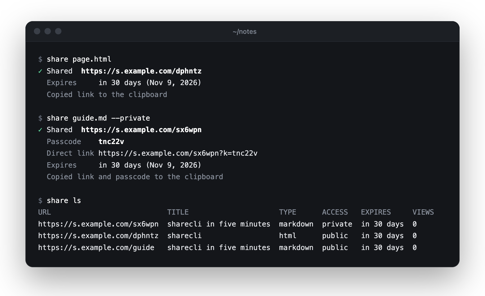
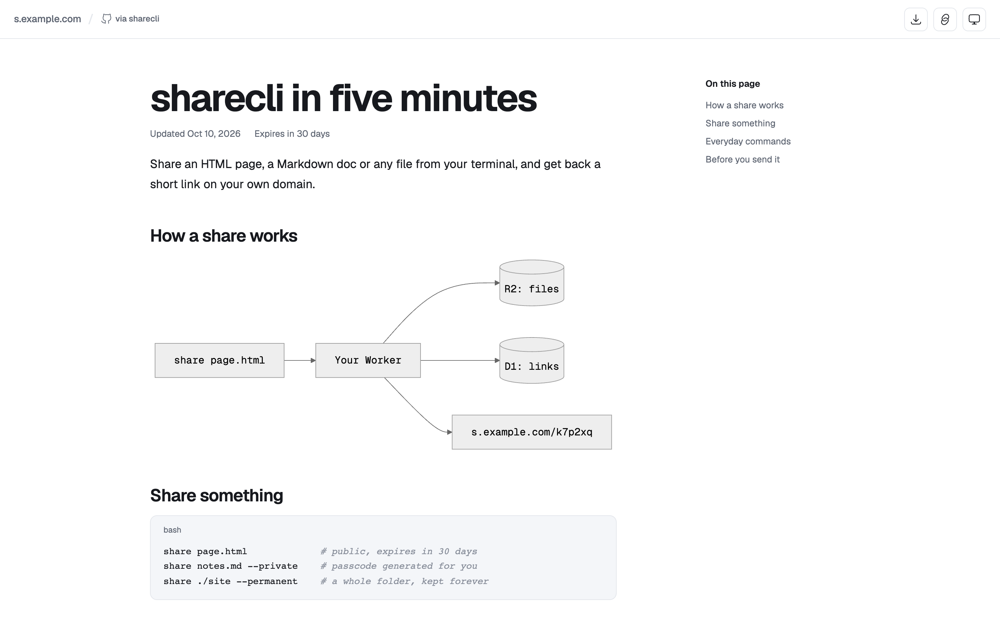
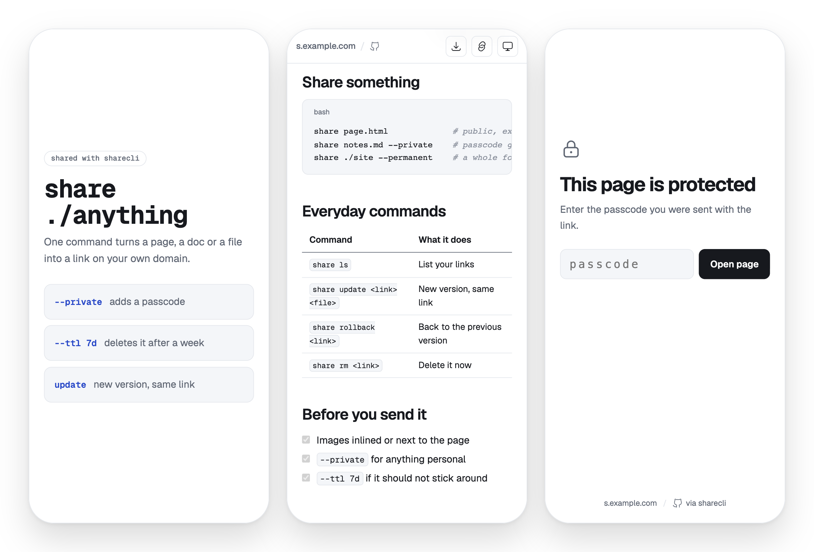

<p align="center">
  
</p>

<h1 align="center">sharecli</h1>

<p align="center">
  Share pages, docs and files from your terminal or AI agent.<br>
  Short links on your own domain, free on Cloudflare.
</p>

<p align="center">
  
  
  
</p>

<p align="center">
  
</p>

## Set it up with your agent

Paste this into Claude Code, Codex or any coding agent:

```text
Set up sharecli for me (https://github.com/alesmartan/sharecli) so you can share pages and files as links.

1. Install the CLI: npm install -g @alesmartan/sharecli
2. Ask me whether links should live on my own domain (a subdomain like s.example.com,
   on a domain I have in Cloudflare) or on a free workers.dev address.
3. Run `npx wrangler whoami`. If I'm not logged in, run `npx wrangler login` and tell me
   to approve it in the browser. If I have several Cloudflare accounts, ask which one to use.
4. Run `share setup --domain <my subdomain> --install-skill`, or `--workers-dev` instead
   of `--domain`, adding `--account-id <id>` if I picked an account.
   If it says R2 isn't enabled, send me to dash.cloudflare.com > R2 to enable it
   (it asks for a card, the free tier costs nothing), then run it again.
   If the subdomain already has a DNS record, ask me to remove it or pick another one.
5. Run `share doctor` and fix anything it flags.
6. Make a small HTML page, share it with `share page.html`, and send me the link.
```

<picture>
  <source media="(prefers-color-scheme: dark)" srcset=".github/assets/viewer-dark.png">
  
</picture>

## Features

| | |
|---|---|
| **HTML, Markdown, any file** | Pages are served as-is. Docs open in a clean reader with dark mode. |
| **Private links** | `--private` adds a passcode, plus a one-tap link for friends. |
| **Auto cleanup** | Links expire after 30 days, or never with `--permanent`. |
| **Versions** | `update` keeps the link. `rollback` undoes the last change. |
| **Built for agents** | `--json` on every command, and a skill for Claude Code, Codex and more. |
| **Free** | Runs on the Cloudflare free plan: Workers, R2 and D1. |

## Quick start

```bash
npm install -g @alesmartan/sharecli
share setup --domain s.example.com
share page.html
```

`setup` logs you in to Cloudflare and deploys your own server. Skip `--domain` for a free `workers.dev` address.

<picture>
  <source media="(prefers-color-scheme: dark)" srcset=".github/assets/phones-dark.png">
  
</picture>

## Commands

```bash
share <file|folder> [--private] [--ttl 7d | --permanent] [--slug name]

share ls                     share update <link> <file>
share info <link>            share rollback <link>
share private <link>         share extend <link>
share public <link>          share rm <link>

share setup | connect | doctor | usage
share upgrade                # update the CLI, the agent skill and your server
```

Run `share --help` for every flag.

## For AI agents

```bash
npx skills add alesmartan/sharecli
```

Then ask your agent to *"make an HTML page about X and share it"*.

<details>
<summary><b>Good to know</b></summary>
<br>

- **R2 needs a card on file.** Cloudflare asks once, even on the free plan. You won't be charged under the limits.
- **More machines:** `share connect https://s.example.com --token <token>`. Get the token with `share config --reveal`.
- **Passcodes keep casual visitors out.** They are not meant for secrets.
- **Limits:** 95 MB per file, 1,000 files per share, 10 GB in total on the free plan.

</details>

## Develop

```bash
pnpm install
pnpm dev     # local server on localhost:8787
pnpm test    # end-to-end tests against a throwaway server
```

## License

MIT
